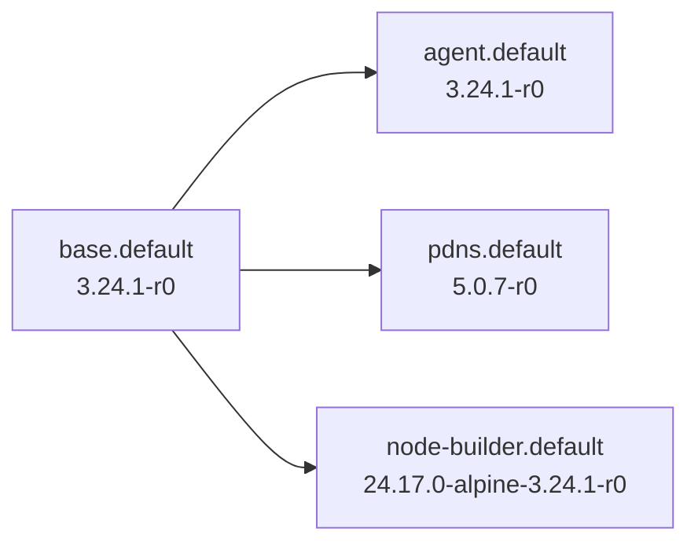

# Dockerfiles

A curated collection of Alpine-oriented container images maintained by Wener.

## Registries

Images are published under these registry namespaces depending on the image family and migration status:

- Docker Hub: `docker.io/wener/<image>:<tag>`
- Quay: `quay.io/wener/<image>:<tag>`
- GHCR: `ghcr.io/wenerme/dockerfiles/<image>:<tag>`

`manifest.yaml` 是版本与依赖管理入口，当前覆盖四个 variant。其余镜像继续使用各目录 Bake。实时配置和 GHCR 状态可运行 `just status --remote` 查看。

## Tagging

Common tag patterns:

- `latest`: moving tag for the default published variant.
- `<version>`: upstream or runtime version, such as `2.0.0`, `24.17.0`, or `18.4`.
- `<version>-r<N>`: rebuild revision for the same upstream version, such as `2.0.0-r0`.
- `<version>-alpine-<alpine>-r<N>`: version plus Alpine base, useful for repeatable consumption.

Prefer revisioned tags for CI and downstream base images when available.

## Image Index

下面区块通过 `just readme` 生成；区块之外的正文保留手工编辑。

<!-- BEGIN GENERATED IMAGES -->

### Manifest 管理的目标版本

来自 `manifest.yaml`。下表是期望发布的版本，不表示已经发布；用 `just status --remote` 查询 GHCR。

| Variant | Build | 策略 | 目标版本 | Alpine | Base | GHCR canonical ref |
|---|---|---|---|---|---|---|
| `base.default` | [base/base](base/base/) · `base` | alpine | `3.24.1-r0` | 3.24.1 | `scratch / Alpine minirootfs` | `ghcr.io/wenerme/dockerfiles/base:3.24.1-r0` |
| `agent.default` | [agent](agent/) · `agent` | alpine | `3.24.1-r0` | 3.24.1 | `base.default` | `ghcr.io/wenerme/dockerfiles/agent:3.24.1-r0` |
| `pdns.default` | [pdns](pdns/) · `pdns` | app | `5.0.7-r0` | 3.24.1 | `base.default` | `ghcr.io/wenerme/dockerfiles/pdns:5.0.7-r0` |
| `node-builder.default` | [node-builder](node-builder/) · `node-builder` | app-alpine | `24.17.0-alpine-3.24.1-r0` | 3.24.1 | `base.default` | `ghcr.io/wenerme/dockerfiles/node-builder:24.17.0-alpine-3.24.1-r0` |

### 依赖关系



### 尚未迁移的 Bake 镜像清单

已跟踪的 Bake 配置共 40 组，manifest 管理 4 个 variant；其余 36 组列在下面。Variants 是默认镜像之外的 Bake target，Base 只列出父镜像仓库。

| Image | Variants | Base |
|---|---|---|
| [app](app/) | ssh | `wener/base` |
| [base](base/) | openrc, app | `alpine`<br>`wener/base` |
| [builder](builder/) | - | `wener/app`<br>`wener/base` |
| [bun](bun/) | - | `oven/bun`<br>`wener/base` |
| [caddy](caddy/) | full, docker-proxy | `caddy`<br>`wener/base` |
| [chromium](chromium/) | - | `wener/xvfb` |
| [continue-server](continue-server/) | - | `wener/base` |
| [dante](dante/) | - | `wener/base` |
| [debian](debian/) | bookworm-backports | `debian` |
| [dev](dev/) | - | `wener/node` |
| [dnsmasq](dnsmasq/) | - | `wener/base` |
| [docker](docker/) | - | `wener/base` |
| [frp](frp/) | frps, frpc | `wener/base` |
| [gitea-runner](gitea-runner/) | - | `wener/builder` |
| [go-builder](go-builder/) | - | `wener/go` |
| [go](go/) | - | `wener/base` |
| [httpd](httpd/) | - | `wener/base` |
| [java](java/) | 8, 8-builder, 8-ui, 17 | `wener/base` |
| [jenkins](jenkins/) | agent | `jenkins`<br>`jenkins/ssh-agent` |
| [juicefs](juicefs/) | - | `wener/base` |
| [ligolo-ng](ligolo-ng/) | - | `golang`<br>`wener/base` |
| [mihomo](mihomo/) | - | `golang`<br>`wener/base` |
| [ml](ml/) | pytorch | `python`<br>`quay.io/wener/pytorch` |
| [surya-ocr](ml/surya-ocr/) | - | `quay.io/wener/pytorch` |
| [nginx](nginx/) | - | `wener/base` |
| [node](node/) | docker | `wener/base` |
| [php](php/) | 81, 82, 83, 84 | `wener/base`<br>`wener/nginx` |
| [postgres](postgres/) | - | `postgres` |
| [samba](samba/) | - | `wener/app` |
| [sing-box](sing-box/) | - | `wener/base` |
| [sni-rev-proxy](sni-rev-proxy/) | - | `wener/base` |
| [next-standalone](templates/next-standalone/) | web | `wener/node` |
| [tinyproxy](tinyproxy/) | - | `wener/base` |
| [ubuntu](ubuntu/) | jammy, focal, bionic, ml | `ubuntu` |
| [xray](xray/) | - | `ghcr.wener.me/xtls/xray-core`<br>`wener/base` |
| [xvfb](xvfb/) | - | `wener/app` |

<!-- END GENERATED IMAGES -->

## Development

This repository uses Bun for scripts and [just](https://github.com/casey/just) for commands. Run `just` to list all recipes. Repository tooling is one CLI, `dfcli` (`scripts/dfcli/main.ts`, built on commander and Bun Shell); `just dfcli --help` lists every command.

```bash
bun install
just check                 # bun check (typecheck), tests, manifest and README checks (same as CI)
just status                # manifest variants and Bake target validation
just status --remote       # also query GHCR canonical tags
just plan base             # dependency-ordered build plan
just publish-plan          # which GHCR tags CI would build
just manifest-bake agent   # GHCR-only Bake JSON preview
just readme                # regenerate the README generated region
just dfcli scan            # any other dfcli command
```

Useful build commands:

```bash
# Inspect bake output for one image group
cd gitea-runner && make -s print

# Build and push one image group
cd gitea-runner && DOCKER_BUILD_PROGRESS=plain make push
```

## GitHub Actions

- `.github/workflows/ci.yml`：PR 和 master push 时运行 typecheck、测试、manifest 校验、README 区块检查和 Bake target 解析，不构建镜像。
- `.github/workflows/ghcr.yml`：`manifest.yaml` 变更推送到 master 后，按依赖顺序构建并推送 GHCR 上缺失的 canonical tag；已存在的 tag 不会重建，要重新发布就递增 `version.revision`。也可以手动触发，指定镜像、平台或 dry-run。

Docker Hub 和 Quay 仍通过各目录的 `make push` 在本地发布。

## Version Maintenance

manifest 管理的镜像直接维护 `version` 字段：`alpine` → `3.24.1-r0`，`app` → `5.0.5-r0`，`app-alpine` → `24.17.0-alpine-3.24.1-r0`。Alpine 可以沿内部 base 继承。默认 variant 不加前缀，其它 variant 使用 `<variant>-<version>`。

现有 Bake/Make 的默认值没有自动回写。`just manifest-bake` 将 manifest 版本、canonical GHCR 标签、OCI labels 和内部父镜像引用解析为完整 JSON；它是配置预览，不执行构建。`just status` 的 `BAKE TAG=generated` 表示该 canonical 标签需要生成配置，`native` 表示现有 Bake 已声明。

以下旧命令仍然修改各镜像 Bake，用于尚未迁移的镜像。`just plan` 只计算构建依赖顺序，不自动递增下游 revision；周期更新与 revision 传播留待后续接入。

```bash
# Preview / write the next revision for one image group
just dfcli rev bump postgres
just dfcli rev bump postgres --write

# Record upstream base image digests; bump only when a tracked digest changed
just dfcli base check postgres --write
just dfcli base check postgres --write --bump

# Compare postgres extension versions with upstream
just postgres-versions
```

`base check` 把上游 base 镜像 digest 记录在 `.github/image-base-digests.json`（首次运行时创建）。没有记录时只建立基线，不递增 revision；已记录的 digest 发生变化才会递增。

## Notes

- Most image groups target `linux/amd64` and `linux/arm64`.
- Docker Hub can be noisy or rate-limited; Quay is often used as a stable build input via bake `contexts`.
- GHCR is available for image groups that declare `ghcr.io/wenerme/dockerfiles/...` tags and when the active Docker config has GHCR credentials.
